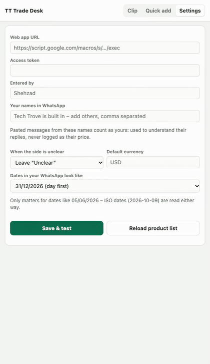
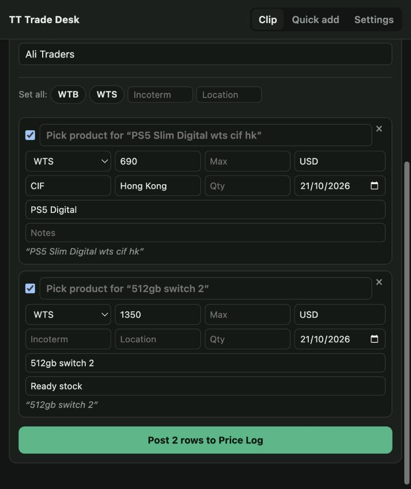
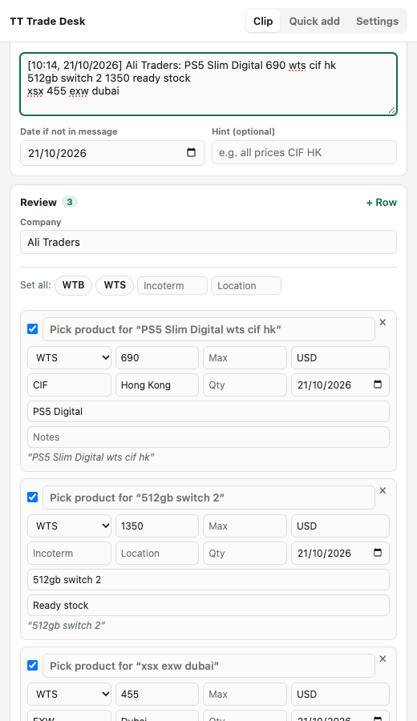
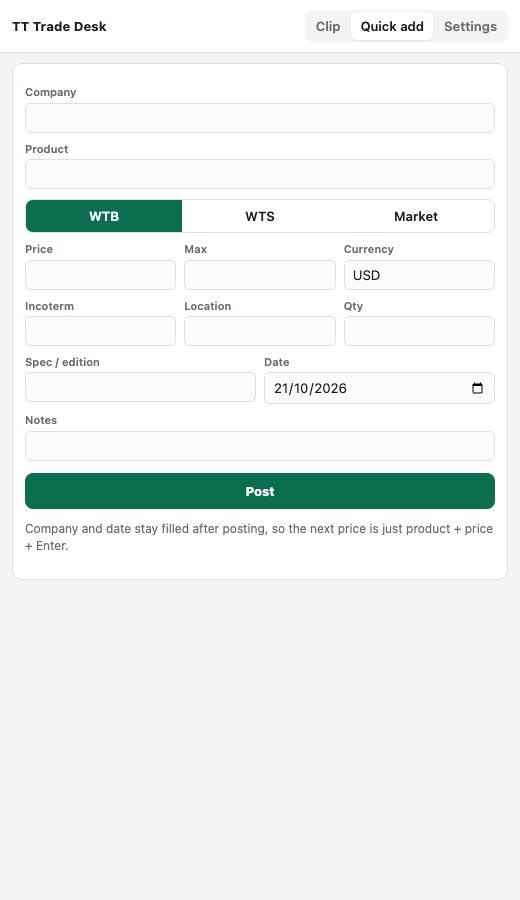

# Trade Desk Clipper

A Chrome extension I built to speed up how our trading team logs prices from WhatsApp into our shared pricing sheet. Instead of retyping product, price, currency and terms by hand for every message, it reads the message and fills in the row for you.

<a href="media/demo.mp4">Watch the full-quality video</a>

## Why I built it

Our team gets dozens of price quotes a day over WhatsApp, in a mix of shorthand, typos and inconsistent formatting ("ps5 digi 690 cif hk", "switch2 1350 rdy stock"). Copying each one into our pricing spreadsheet by hand was slow and error-prone. I wanted something that understood that shorthand well enough to fill in most of the row automatically, while still leaving the final check to a person before anything gets saved.

## What it does

- Adds a button next to WhatsApp messages (or a side panel you can paste into) that reads the text and pulls out product, price, currency, quantity, shipping terms and location
- Matches shorthand and typos against the product catalogue ("switch two", "swtich", "ns2" all resolve to the same product)
- Tells the difference between someone asking to buy and someone offering to sell, from the wording and context
- Learns from corrections — if you fix a match, it remembers that mapping for next time
- Lets you review and edit every row before anything is posted to the sheet
- Runs entirely with simple rule-based text parsing — no AI service or external API involved, so results are instant and don't depend on an internet-connected model

## Screenshot

A sample message pasted into the panel, parsed into editable rows ready to review and post:

 

The quick add form, for logging a single price by hand:

## Tech used

A Chrome extension (JavaScript) paired with a small Google Apps Script backend that reads from and writes to a Google Sheet.

---

This repository is a public overview only — the parsing rules and backend script are kept private.
